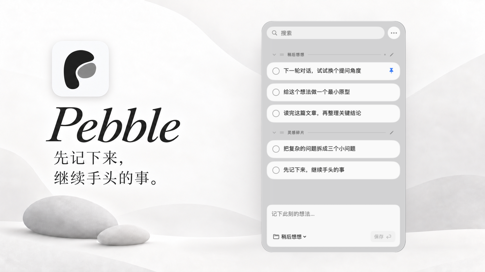

# Pebble

Pebble 是一款为 AI 工作中的零散想法设计的 macOS 菜单栏便笺。和 AI 对话、写代码或查资料时，突然想到另一个问题、方向或待办，可以把它记下来，继续手头的工作，之后再处理。

每个念头都像一颗鹅卵石，先收进 Pebble。笔记保存在本机，无需账号、云同步或追踪。

<p align="center">
  
</p>

## 首次打开前：手动允许运行

当前发布版未使用付费的 Apple Developer ID 签名和公证，因此应用使用 ad-hoc 临时签名。首次打开时，macOS Gatekeeper 可能会拦截应用。建议先将 `Pebble.app` 移到 **应用程序**，再从以下方式中选择一种允许打开：

1. **在 Finder 中打开**：按住 Control 并点按 `Pebble.app`（或右键），选择 **打开**；在随后出现的确认提示中再次选择 **打开**。
2. **在系统设置中允许**：先尝试打开 Pebble；被拦截后，进入 **系统设置 → 隐私与安全性**，向下找到安全性提示并点击 **仍要打开**，再确认打开。详情见 [Apple 关于安全打开 Mac 应用的说明](https://support.apple.com/en-us/102445)。
3. **使用终端移除隔离属性**：如果应用已放在“应用程序”文件夹，可运行：

   ```sh
   xattr -dr com.apple.quarantine /Applications/Pebble.app
   ```

   如果应用不在该位置，请将命令中的路径替换为实际的 `Pebble.app` 路径。只对从可信来源获取的应用执行上述操作。

## 主要功能

### 在界面里记录想法

打开 Pebble 的浮动面板，在底部输入框写下刚想到的问题、灵感或待办。输入区会随内容增加而扩展；点击 **保存 ↵** 按钮或按 **Return** 保存为一条笔记，按 **Shift-Return** 换行。新想法会加到当前分组。先把念头安放下来，之后再决定如何处理。

例如，在 AI 对话中想到一个稍后要追问的问题，或在写代码时冒出另一个验证方向，都可以先记成一颗 Pebble，回到正在进行的工作。

## 辅助功能

辅助功能帮助你更快收集、整理和找回已经记录的想法：

- **快捷收集与浏览**：在其他应用选中文字后快速按下并松开两次 **Shift**，即可捕获到当前分组；也可自定义捕获快捷键和显示 / 隐藏面板的全局快捷键。点击菜单栏图标可打开 popup，浏览和复制已有便笺。
- **整理与查找**：创建分组、拖动排序、置顶或标记完成；按笔记内容或分组名称搜索，并可展开查看长笔记。支持 Markdown 展示。
- **编辑与批量处理**：在卡片内或独立窗口编辑；多选后复制、合并、移动、完成或删除，并支持撤销与重做。
- **本地数据保护**：笔记和分组自动保存在本机；支持 JSON 导入导出、自动备份和启动时恢复。
- **个性设置**：界面支持简体中文和英文，可调整外观、窗口置顶和登录时启动。

## 下载、安装与启动

下载最新版请前往 [GitHub Releases](https://github.com/tuntun0609/pebble/releases/latest)，下载 `Pebble-<版本>.dmg` 并将 `Pebble.app` 拖到“应用程序”。首次打开时若被 macOS 拦截，请按上文“首次打开前：手动允许运行”操作。

### 从源码构建

需要 macOS 14 或更新版本，以及带 macOS SDK 的 Apple Command Line Tools。

在项目目录运行：

```sh
./build.sh
open "build/Pebble.app"
```

构建产物是 `build/Pebble.app`。项目直接使用 `swiftc` 编译，无第三方依赖，也不需要完整的 Xcode 工程。默认构建当前 Mac 架构，并使用本地临时签名。

Pebble 启动后常驻菜单栏，不显示 Dock 图标。点击菜单栏图标可打开或收起 popup，在其中浏览和复制便签；选择 **⋯ → 打开 Pebble** 可打开完整浮动面板。退出应用请选择 **⋯ → 退出 Pebble**。修改源码后，重新运行构建脚本并重启应用即可。

## 日常使用

### 记录、搜索与编辑

- 在面板底部输入内容；输入区会随内容增加而扩展。点击 **保存 ↵** 按钮或按 **Return** 新建笔记，按 **Shift-Return** 换行。新笔记追加到当前分组末尾。
- 使用顶部搜索框按笔记内容或分组名称查找；按 **⌘F** 聚焦搜索，按 **Esc** 清空搜索或关闭面板（依当前焦点而定）。
- 点击笔记卡片选择它。**Command-点击** 可追加或取消选择，**Shift-点击** 可选择连续范围。右键卡片可复制、编辑、移动或合并。
- 在卡片内编辑，或选择在独立窗口编辑。笔记支持标题、粗体、斜体、链接、行内代码、代码块、引用、列表和分隔线等 Markdown 展示。
- 多选笔记后可复制、复制为编号列表、合并、移动、标记完成或删除。合并按界面中的分组与笔记顺序排列，并以空行分隔内容。

### 分组与排序

从 **⋯ → 新建分组…** 创建分组；点击分组标题切换当前分组，点击标题旁的铅笔按钮或右键标题可重命名。删除分组时，可以把笔记移到其他分组，也可以连同笔记一起删除。应用始终保留至少一个分组。

点击分组标题左侧的箭头可折叠或展开分组；折叠后，标题旁会显示当前可见笔记的数量。折叠状态会在重启后保留。搜索时，匹配的笔记会自动展开显示，期间不能切换分组的折叠状态；清空搜索后，恢复搜索前的折叠状态。

拖动分组标题可改变分组顺序。拖动笔记卡片可调整顺序或将笔记移到其他分组；蓝色插入线会提示放置位置，拖到分组标题可移至组首，空分组也可作为放置目标。拖动时将鼠标停在列表顶部或底部边缘可自动滚动。松手后才保存移动，可按 **⌘Z** 撤销；拖动中按 **Esc** 可取消。

右键笔记可置顶。置顶笔记排在所属分组最前面，可继续编辑、移动、完成或删除；在置顶笔记之间拖动可调整顺序。取消置顶后，笔记排在本组未置顶笔记之前。完成的笔记默认隐藏，可通过 **⋯ → 显示已完成** 查看；可在 **⋯ → 清理已完成** 删除全部已完成笔记，或右键分组标题清理本组已完成笔记。删除前会确认，删除后可按 **⌘Z** 撤销。

### 捕获其他应用中的选中文字

在其他应用选中文字，快速完整地按下并松开两次 **Shift**。捕获后，内容会保存到当前分组并显示在面板中，原应用保持焦点。若没有检测到选区，Pebble 会打开输入框供你直接记录。

首次使用跨应用捕获时，需要授予辅助功能权限：

1. 打开 **设置 → 捕获**，点击 **启用…**。
2. 在 **系统设置 → 隐私与安全性 → 辅助功能** 中允许 `Pebble.app`。若列表中没有 Pebble，可点击 **+** 添加。
3. 返回 Pebble；若权限还未生效，退出并重新打开应用。

在 **设置 → 捕获 → 录制…** 可改用包含 Command、Option 或 Control 的组合键；点击 **重置** 可恢复双 Shift。Pebble 优先通过辅助功能接口读取选区；目标应用不支持时，会尝试复制选中文字，并在剪贴板未被其他操作修改时恢复原内容。密码字段和系统安全输入状态下不会捕获。若权限失效，可在系统设置中移除旧条目，再添加当前应用。

### 快捷键

除全局捕获和面板唤起快捷键外，下表快捷键在主面板中使用。卡片操作快捷键仅在面板获得焦点且未编辑文字时生效；编辑文字时保留系统的复制、粘贴和撤销操作。

| 快捷键 | 操作 |
| --- | --- |
| 双 Shift / 自定义组合键 | 全局捕获选中文字 |
| 自定义组合键（默认关闭） | 全局显示 / 隐藏面板 |
| ⌘N / ⌘F | 聚焦新建输入框 / 搜索 |
| ↑、↓ / Shift-↑、Shift-↓ | 选择卡片 / 扩展选择 |
| ⌘A | 选择全部可见笔记 |
| ⌘C / Shift-⌘C | 复制 / 复制为编号列表 |
| Space | 切换完成状态 |
| Return / ⌘Return | 卡片内编辑 / 在独立窗口编辑 |
| Shift-⌘M | 合并所选笔记 |
| Delete | 删除所选笔记 |
| ⌘Z / Shift-⌘Z | 撤销 / 重做 |
| Esc | 取消编辑、清空搜索或隐藏面板，依当前焦点而定 |

独立编辑窗口中，**Return** 换行，**⌘Return** 保存，**Esc** 取消。

### 语言与窗口

在 **Settings → General → Language**（**设置 → 通用 → 语言**）中选择 **English** 或 **简体中文**。首次使用默认英文，切换后立即生效并在下次启动时保留；笔记内容和分组名称不会改变。

在 **设置 → 窗口** 中调整窗口置顶、浅色或深色外观、跟随系统以及登录时启动。拖动搜索栏上方或下方的空白区域可以移动面板。

## 本地数据、备份与迁移

笔记和分组的修改会自动保存。通过 **⋯ → 显示本地文件** 或 **设置 → 数据管理 → 在访达中显示笔记** 打开数据目录。默认位置为：

```text
~/Library/Application Support/Pebble/
├── notes.json
└── notes.backup.json
```

`notes.json` 保存当前数据，`notes.backup.json` 保留前一次有效保存的数据。备份是单份轮换文件，不是完整历史。文件采用原子替换；若启动时主文件损坏或缺失，应用会尝试从备份恢复。若无法恢复，应用会保留原文件、提示错误并停止保存。

### 导出与导入

在 **设置 → 数据管理 → 导出笔记…** 中，可将全部笔记和分组导出为带格式版本号的 JSON 文件。导出包含已完成和置顶笔记、排列顺序及创建和修改时间，不受搜索或隐藏已完成状态影响；窗口、外观、语言和快捷键等应用设置不包含在内。

选择 **导入笔记…** 可导入 Pebble 导出的 JSON 或现有的 `notes.json`。应用会先校验整份文件并显示预览，再确认合并：

- 已存在相同 ID 的笔记保留本地版本，不覆盖本地修改；不同 ID 的笔记即使正文相同也会保留。
- 分组先按 ID、再按名称匹配；匹配到现有分组时沿用本地名称，否则新增分组。
- 已有顺序保持不变；新笔记追加到相应分组末尾，新分组追加到列表末尾，导入内容保留相对顺序，置顶笔记仍显示在组内最前面。
- 每次有新增内容的导入都会额外保存一份 `notes.before-import-<时间>-<UUID>.json`，可用于在访达中手动恢复；应用没有历史记录导入入口。导入也可按 **⌘Z** 撤销、按 **⇧⌘Z** 重做。
- 校验、备份或保存失败时不会修改当前数据。重复导入不会新增副本；若没有新增内容，不会写入文件或创建备份。若本地数据在预览期间发生变化，需要重新选择文件以查看最新预览。

导出时不能覆盖应用正在使用的 `notes.json` 或 `notes.backup.json`。从旧版升级时，如果新数据目录还不存在，应用会自动迁移旧笔记并沿用偏好设置；辅助功能权限和登录启动可能需要重新启用。

日常备份和迁移建议使用导入导出。若要整库替换，请先退出 Pebble，再复制或替换数据目录中的文件。窗口、外观、语言和快捷键等偏好由系统单独保存，不包含在笔记 JSON 中。笔记操作支持当前运行期间最多 100 个撤销快照，连续编辑可能合并为一个步骤；撤销记录不跨重启保留。

也可通过命令行指定其他笔记目录：

```sh
"build/Pebble.app/Contents/MacOS/Pebble" --data-dir "/完整路径/笔记目录"
```

自定义目录只改变笔记文件位置，应用设置仍共用。请勿同时运行多个实例修改同一数据目录。

## 开发构建

默认在项目目录执行 `./build.sh`，构建当前架构的本地开发版。可用环境变量调整构建：

| 环境变量 | 用途 |
| --- | --- |
| `VERSION` | 写入应用版本号；设置后构建标记为 release |
| `ARCHS` | 空格分隔的目标架构，例如 `"arm64 x86_64"` |
| `SIGN_IDENTITY` | 指定签名身份；默认 `-`，即 ad-hoc 临时签名 |
| `ENTITLEMENTS` | 指定可选的 entitlements plist 路径 |
| `MIN_MACOS` | 最低 macOS 部署版本；默认 `14.0` |

未设置 `VERSION` 的本地构建是开发版本，不参与应用内自动更新。修改源码后，重新构建并重启应用即可。

## 自动发布与更新

推送 `v` 开头的标签（例如 `v1.1.0`）会触发 GitHub Actions（`.github/workflows/release.yml`）。也可在仓库的 **Actions → Release → Run workflow** 手动触发，并输入不带 `v` 的版本号（例如 `1.1.0`）。发布标签是版本号的唯一来源，会写入 `Info.plist`。

工作流在 `macos-latest` 上构建 `arm64 + x86_64` 通用应用，并发布以下文件：

- `Pebble-<版本>.dmg`：包含可拖至 `/Applications` 的应用。
- `Pebble-<版本>.zip`：供应用内更新使用。
- `Pebble-<版本>.sha256`：发布文件的 SHA256 校验和。
- `latest.json`：应用读取的更新信息。

创建并推送版本标签：

```sh
git tag v1.1.0
git push origin v1.1.0
```

正式发布版启动约 3 秒后检查更新，之后每 6 小时检查一次；可在 **设置 → 通用 → 检查更新** 手动检查或关闭自动检查，也可通过 **⋯ → 检查更新…** 手动检查。应用从 GitHub Release 资产读取 `latest.json`，不调用 GitHub REST API。

有新版本时，应用会下载 ZIP，校验 SHA256、包标识、版本号和签名开发者，然后替换应用并提示重启。更新只替换应用本身，不影响笔记和偏好设置。若应用从 App Translocation 临时路径（例如首次直接从下载目录打开）或只读卷运行，更新会提示先将应用移到 **应用程序**。如果 fork 或重命名仓库，请同步修改 `Sources/Pebble/UpdateService.swift` 中的 `defaultFeed` 地址。

## 签名与公证

签名与公证是可选的，由仓库 Secrets 控制：

- 未配置证书时，应用使用 ad-hoc 临时签名。首次打开下载版时若被 Gatekeeper 拦截，请按文首“首次打开前：手动允许运行”中的方法处理。
- 配置 Developer ID 后，应用会在 hardened runtime 下签名，DMG 会经 Apple 公证并 staple。用户可直接双击运行。这需要付费的 Apple Developer 账号。

在仓库 **Settings → Secrets and variables → Actions** 中配置：

| Secret | 说明 |
| --- | --- |
| `MAC_CERTIFICATE_P12` | Developer ID Application 证书（.p12）的 base64 内容 |
| `MAC_CERTIFICATE_PASSWORD` | `.p12` 导出密码 |
| `APPLE_API_KEY_P8` | App Store Connect API 私钥（.p8）内容，推荐 |
| `APPLE_API_KEY_ID` | API Key ID |
| `APPLE_API_ISSUER` | Issuer ID |
| `APPLE_ID` | 不使用 API Key 时的 Apple 账号邮箱 |
| `APPLE_APP_SPECIFIC_PASSWORD` | 不使用 API Key 时的应用专用密码 |
| `APPLE_TEAM_ID` | 不使用 API Key 时的团队 ID |

生成 `MAC_CERTIFICATE_P12`：在「钥匙串访问」中选择 *Developer ID Application* 证书及其私钥，右键导出为 `.p12` 并设置密码，然后运行 `base64 -i Certificates.p12 | pbcopy`，将内容粘贴为 Secret。公证凭据使用 App Store Connect API Key（`APPLE_API_KEY_P8`、`APPLE_API_KEY_ID`、`APPLE_API_ISSUER`）；若未配置 API Key，则使用 Apple ID 及其专用密码和团队 ID。

## 许可证

Pebble 使用 [MIT 许可证](LICENSE)。
